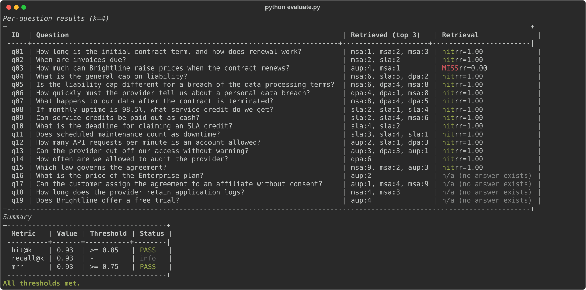
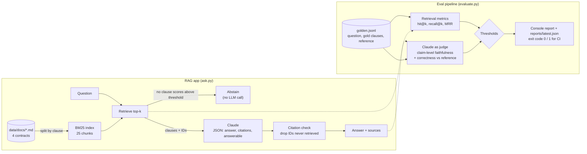

# Contract RAG + Evals

**Live demo: [rag-eval-engine-tau.vercel.app](https://rag-eval-engine-tau.vercel.app/)**

A small question-answering tool for legal contracts, paired with an **automated evaluation pipeline** that measures **retrieval accuracy** and **hallucination rate** on every run. It's built on Claude, with ~600 lines of Python and no vector database.



<sub>Output of `python evaluate.py --retrieval-only`. Run `python evaluate.py --svg docs/eval-report.svg` with an API key to generate the full report with judge scores, and `vhs docs/demo.tape` to record a GIF of the app.</sub>

---

## The problem

"Chat with your documents" demos are easy to build and hard to trust. In a legal setting, a confident wrong answer is worse than no answer: a model that says breach notice is due "within 72 hours" (a common figure in other contracts) when this contract says **48** is a liability.

So this project focuses on the question most RAG demos skip: **how do you know it works?**

- **Did retrieval find the right clause?** Scored against hand-labelled gold clauses.
- **Is every claim in the answer backed by the retrieved text?** That is the hallucination check.
- **Is the answer actually correct?** Scored against human-written reference answers.
- **Does it say "I don't know" when the documents don't cover the question?**

The answers to those four questions are numbers with thresholds, and `evaluate.py` exits non-zero when one of them regresses, so a prompt tweak or retriever change can be gated in CI like any other code change.

## What it measures

| Metric | What it means | How it is computed | Needs API? |
|---|---|---|---|
| **hit@k** | Was at least one correct clause retrieved? | Gold clause IDs vs. top-k results | No |
| **recall@k** | Share of the needed clauses retrieved (multi-clause questions) | Same | No |
| **MRR** | How high the first correct clause ranked | 1 / rank | No |
| **faithfulness** | Share of answer claims supported by the retrieved context | LLM judge splits the answer into atomic claims and verifies each | Yes |
| **hallucination rate** | Share of answered questions with at least one unsupported claim *or* a fabricated citation | Judge + citation check | Yes |
| **answer correctness** | Matches the human reference answer (correct = 1, partial = 0.5) | LLM judge with a rubric | Yes |
| **abstention accuracy** | Share of unanswerable questions the app correctly refused to answer | Deterministic | Yes |

The golden set ([data/golden.jsonl](data/golden.jsonl)) has **19 questions**: 15 answerable (including a multi-clause one and one that needs arithmetic over a credit table) and **4 deliberately unanswerable** ones ("What is the price of the Enterprise plan?"), because the most common RAG failure is answering anyway.

## Architecture



## Quickstart

Requires Python 3.10+.

```bash
git clone <your-repo-url> && cd <repo>
python -m venv .venv && source .venv/bin/activate   # Windows: .venv\Scripts\activate
pip install -r requirements.txt

# 1. Free, offline: unit tests + retrieval eval (no API key needed)
pytest -q
python evaluate.py --retrieval-only

# 2. Ask questions (needs a key from https://console.anthropic.com)
export ANTHROPIC_API_KEY=sk-ant-...                 # Windows: $env:ANTHROPIC_API_KEY="sk-ant-..."
python ask.py "How quickly must a personal data breach be reported?"
python ask.py                                       # interactive mode

# 3. Web UI at http://127.0.0.1:8000
uvicorn app:app --reload

# 4. Full eval: RAG answers + LLM judge
python evaluate.py
python evaluate.py --limit 5 --k 3                  # quicker / different k
```

A full run makes about 38 Claude calls (one answer and up to one judgment per question). Per-question details, including every unsupported claim and the judge's reasoning, are written to `reports/latest.json`.

| Env var | Default | Purpose |
|---|---|---|
| `ANTHROPIC_API_KEY` | (none) | Required for answering and judging |
| `RAG_MODEL` | `claude-opus-5-5` | Model that answers questions |
| `RAG_JUDGE_MODEL` | same as `RAG_MODEL` | Model that grades answers |

## Deploy to Vercel

The web UI is a FastAPI app ([app.py](app.py)) serving one HTML page ([web/index.html](web/index.html)). Vercel detects it with no build config.

1. On [vercel.com/new](https://vercel.com/new), import this GitHub repo and keep the defaults (Framework: FastAPI).
2. Under **Environment Variables**, add `ANTHROPIC_API_KEY`. Optionally add `RAG_MODEL` and `RATE_LIMIT_PER_MINUTE` (default 5 per IP).
3. Deploy. Every push to `main` redeploys, and pull requests get preview URLs.

A public demo spends your API credit. The app caps questions at 300 characters and rate-limits per IP, but that limiter is in memory per server instance, so also **set a monthly spend limit in the Anthropic Console**.

## Project structure

```
data/docs/          4 short fictional contracts (MSA, DPA, SLA, AUP)
data/golden.jsonl   eval set: question, gold clause IDs, reference answer
rag/chunker.py      markdown -> one chunk per numbered clause ("msa:6")
rag/retriever.py    BM25, pure Python
rag/llm.py          Claude call with structured JSON output + refusal handling
rag/pipeline.py     retrieve -> answer -> validate citations
evals/              retrieval metrics + LLM judge
evaluate.py         runs the suite, prints the report, enforces thresholds
ask.py              CLI
app.py, web/        FastAPI + single-page UI (deployed on Vercel)
tests/              offline tests (LLM mocked)
.github/workflows/  CI: offline eval on every push, full eval on main
```

## Architecture & Decisions

### 1. BM25 instead of embeddings and a vector DB
Contract questions hinge on exact terms like "indemnification", "subprocessor" and "99.9%", which lexical search handles well. The corpus is small, and BM25 is **deterministic**, so the retrieval eval runs offline, for free, and gives the same result on every CI run. A vector DB would add a service, an embedding API and non-determinism for no measurable gain at this size.

**The trade-off is visible in the eval.** q03 asks how much Brightline can *"raise prices"*, but the contract says *"increase fees"*. BM25 misses it (hit@k = 0.93, not 1.0), the generator then correctly abstains, and that shows up as a correctness miss rather than a hallucination. That's the eval doing its job: it tells you exactly when hybrid retrieval (BM25 + embeddings, or query rewriting) becomes worth adding, and the threshold tells you whether the change helped.

### 2. Chunk by clause, not by fixed token windows
Contracts are already split into numbered clauses, so each clause is a self-contained unit that a lawyer would cite. Clause chunks never cut a sentence such as "except for the Excluded Claims..." in half, and they give stable, readable IDs (`msa:6`). Those IDs are what the golden set labels, what the model cites, and what the citation check validates. Fixed windows would need overlap tuning and would break all three.

### 3. RAGAS-style metrics written out, instead of importing RAGAS / DeepEval
The faithfulness metric is the RAGAS definition: split the answer into claims, verify each against the context. It takes about 60 lines ([evals/judge.py](evals/judge.py)). Writing it directly kept the project simple and transparent:
- **No hidden prompts.** The judge rubric is right there to read and tune, which matters when the judge's verdict is the metric.
- **Fewer dependencies.** Both frameworks default to OpenAI and pull in large dependency trees, which would otherwise need adapters to run on Claude.
- **One judge call per question** returns claims *and* correctness via a JSON schema, instead of several framework calls per metric.

If the project grew (many metrics, dashboards, dataset versioning), adopting DeepEval or RAGAS would be the right call. The golden-set format here maps directly onto their test-case objects.

### 4. Structured outputs, not parsing free text
Both the generator and the judge return JSON constrained by a schema (`output_config.format`), so there's no regex scraping of "Answer: ..." and no flaky parse failures skewing the metrics. The generator's `answerable` flag makes abstention a field the eval can score, not a phrase to string-match.

### 5. The judge only sees what the generator saw
Faithfulness is checked against the **retrieved** clauses, not the whole corpus. A claim that happens to be true in a clause that wasn't retrieved still counts as unsupported, because the model didn't get it from its context, which means it came from priors. That's exactly the behaviour you want to catch in legal QA.

### 6. Unanswerable questions in the golden set
A RAG system that answers everything scores well on most demo evals. Four questions have no answer in the corpus, and the app is scored on refusing them (abstention accuracy) and penalised for refusing answerable ones (false abstention rate). Optimising one at the expense of the other shows up immediately.

### Edge cases handled

| Situation | Handling |
|---|---|
| Nothing relevant retrieved | Retriever drops clauses below a minimum BM25 score; with no context the app abstains **without calling the model** (no cost, nothing to hallucinate from). |
| Model cites a clause it was never shown | Citation is dropped, shown to the user, and counted as a hallucination in the eval. |
| Instructions hidden inside a document (prompt injection) | Documents are wrapped in `<documents>` tags, and the system prompt states that their text is content, not instructions. |
| Question answerable only in part | Prompt allows a partial answer that says which part isn't covered; the judge scores it `partial`. |
| Safety classifier declines a request | Server-side fallback (`fallbacks="default"`) retries on a fallback model. If the whole chain declines, a clear error is raised instead of an empty answer. |
| Output cut off at `max_tokens` | Detected and raised instead of parsing truncated JSON. |
| One question errors during an eval | Recorded per question; the run continues, and any error fails the gate. |
| LLM-as-judge bias | Judge uses a strict rubric and a human reference answer. Set `RAG_JUDGE_MODEL` to use a different model than the generator. |

### Known limitations
- **19 questions is a smoke test, not a benchmark.** One question moves a metric by 5-7 points. Grow the golden set before trusting small differences.
- **The judge is a model.** Spot-check `reports/latest.json` against your own reading before trusting a new judge prompt.
- **The contracts are fictional and short.** Real contracts have nested sub-clauses, definitions sections and cross-references ("as defined in Section 1.4"), which would need definition-aware retrieval.

## Using your own documents
Drop markdown files into `data/docs/` with numbered `## 1. Heading` clauses, then write questions with gold clause IDs and reference answers in `data/golden.jsonl`. `pytest` checks that every gold ID exists.

---

*Brightline Data, Inc. and all contract text in `data/docs/` are fictional and for demonstration only. Nothing here is legal advice.*
